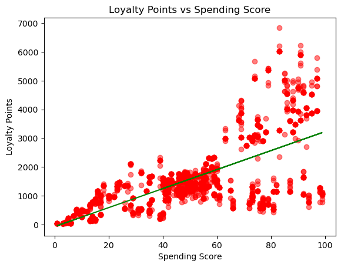
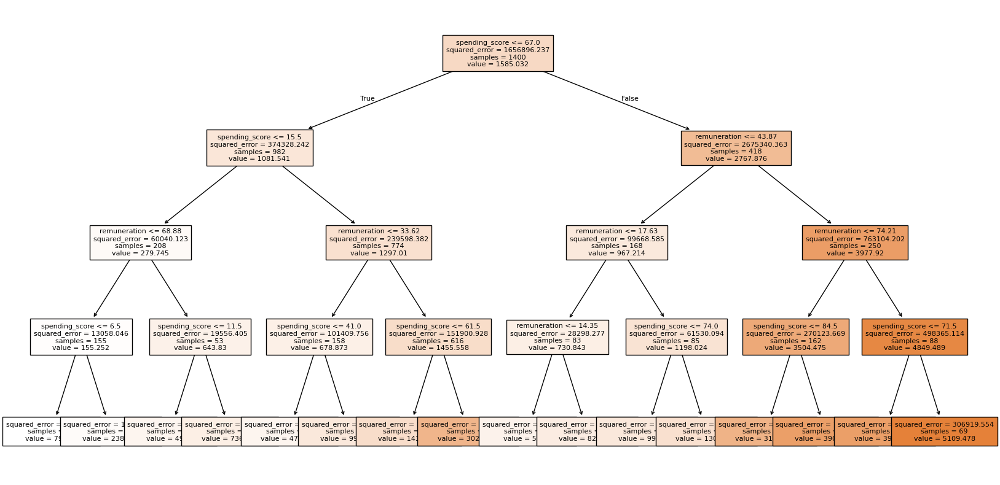
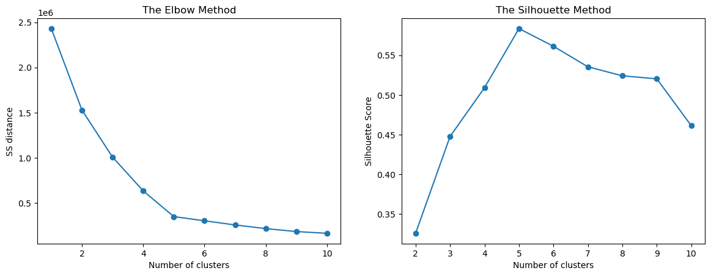
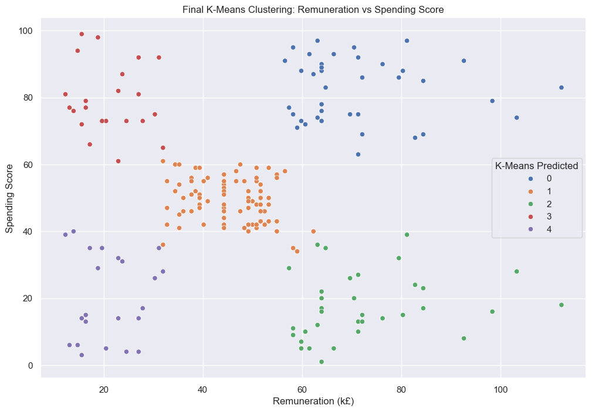
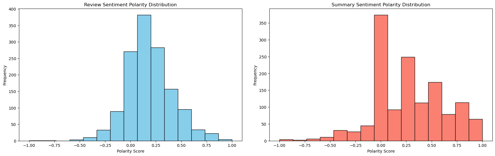
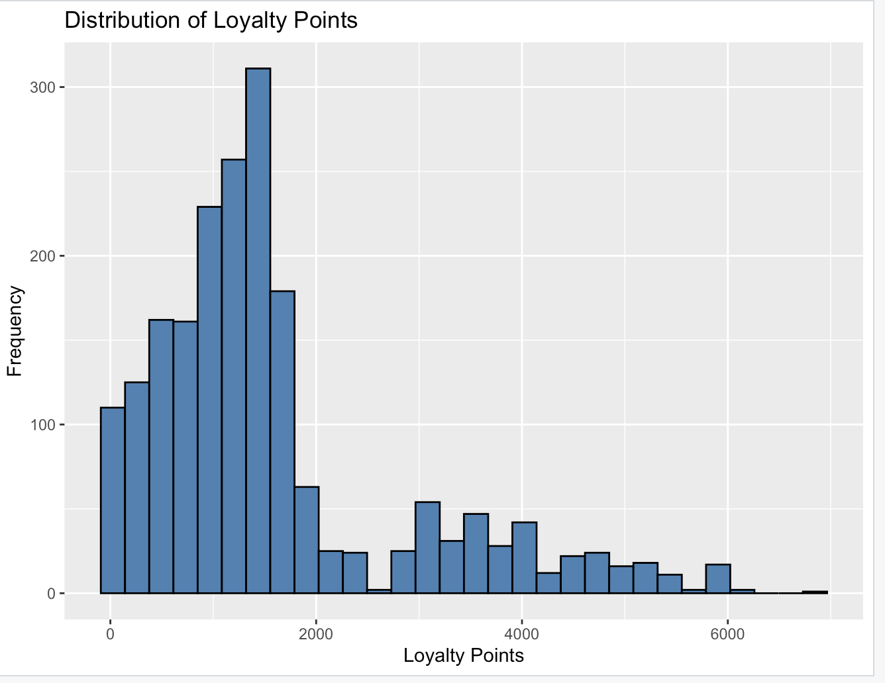
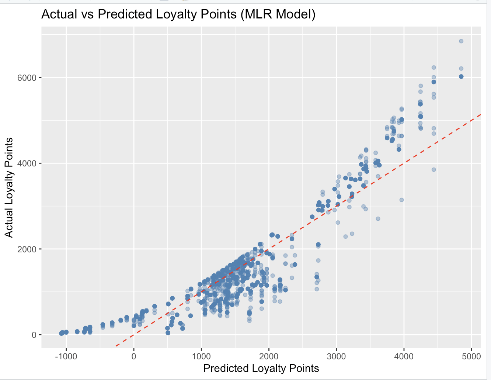

# 🐢 Turtle Games: Customer Loyalty, Segmentation & Sentiment Analysis

An end-to-end customer analytics project for **Turtle Games**, a global retailer of books, board games, video games and toys. Using Python and R, I analysed 2,000 customer records and their product reviews to explain how customers earn loyalty points, identify which customer groups marketing should target, and test what review data can tell the business.

---

## 📌 Business Context

Turtle Games collects sales and review data but has not used it to guide decisions. Its objective is to improve sales performance by understanding customer trends.

### Business questions
1. How do customers accumulate loyalty points?
2. How can customers be segmented, and which groups should marketing target?
3. How can review text inform marketing and business improvements?
4. Is the loyalty points data suitable for building predictive models?

---

## 🛠️ Tools & Techniques

| Tool/Library | Used for |
|---|---|
| **Python** (pandas, NumPy) | Data cleaning and exploration |
| **scikit-learn** | Linear regression, decision tree regressor, K-Means clustering |
| **NLTK, TextBlob, WordCloud** | Text cleaning, tokenisation, sentiment scoring |
| **Matplotlib, Seaborn** | Python visualisations |
| **R** (tidyverse, ggplot2, car) | EDA, multiple linear regression, model diagnostics |

---

## 📂 Repository Contents

| Folder / File | Contents |
|---|---|
| [`notebooks/`](notebooks/) | Python notebook: data cleaning, regression, decision tree, clustering, NLP |
| [`r-scripts/`](r-scripts/) | R script: EDA and multiple linear regression |
| [`reports/`](reports/) | Technical report and Presentation (PDF) |
| [`images/`](images/) | Charts used in this README |
| `requirements.txt` | Python libraries needed to run the notebook |

---

## 🔍 Analytical Process

### 1. Data preparation
- Loaded 2,000 rows × 11 columns and confirmed there were **no missing values**.
- Dropped `language` and `platform` (identical value in every row, so no analytical value).
- Renamed columns for clarity and saved one clean file, used by **both Python and R** so results could be cross-checked.

### 2. Linear regression: what drives loyalty points?
Each variable was tested on its own to set a baseline before building more complex models.

| Variable | R² | Finding |
|---|---|---|
| Spending score | 0.452 | Strongest single driver |
| Remuneration | 0.380 | Moderate driver |
| Age | 0.002 | No meaningful relationship |

The spending score plot shows **two distinct bands** rather than one straight line: above a spending score of about 60, a separate group of customers earns points much faster. A single straight line cannot capture this, which is why linear fit is only moderate.

### 3. Decision tree: capturing non-linear behaviour
- 70:30 train/test split. The unpruned tree overfitted (perfect training score, weaker test score).
- Pruning (`max_depth=4`, `min_samples_leaf=5`) brought training and test performance into line.

| Model | Training R² | Test R² |
|---|---|---|
| Pruned decision tree | **0.946** | **0.943** |

The tree splits first on **spending score (≤ 67)**, then on **remuneration** in every branch. **Age is never used.** This model explains 94% of the variation in loyalty points, more than double the best single linear model.

### 4. K-Means clustering: customer segmentation
Customers were clustered on remuneration and spending score. The **Elbow** and **Silhouette** methods both pointed to **k = 5**, and visual comparison of k = 4, 5 and 6 confirmed five as the cleanest separation.

| Segment | Customers | Share | Marketing view |
|---|---|---|---|
| High income, high spend | 356 | 17.8% | Most valuable: retain and reward |
| Mid income, mid spend | 774 | 38.7% | Largest group: needs further sub-segmentation |
| **High income, low spend** | **330** | **16.5%** | **Biggest untapped opportunity** |
| Low income, high spend | 269 | 13.5% | Highly engaged: loyalty rewards, affordable add-ons |
| Low income, low spend | 271 | 13.6% | Lowest priority: value-led offers |

### 5. NLP & sentiment analysis: what customers say
- Lowercased text, removed punctuation and stopwords, and tokenised reviews.
- **Dropping duplicates cut the reviews from 2,000 to 1,385**, so nearly a third of the review text was repeated or generic.
- Scored every review and summary for polarity (-1 to +1) using TextBlob.

Most reviews score between 0 and 0.35, so **sentiment leans mildly positive**. The large spike at 0 in summaries most likely comes from short headlines (such as "Five Stars") that the tool cannot score, not genuinely neutral customers.

### 6. EDA in R
- **Gender** makes no meaningful difference (female mean 1,601 vs male 1,549 points).
- Loyalty points are **right-skewed** (mean 1,578 vs median 1,276), with a long tail up to about 7,000.
- The R scatterplot reproduced the same two-band pattern found in Python, confirming it with a second tool.

### 7. Multiple linear regression in R
Model: `loyalty_points ~ remuneration + spending_score`

| Metric | Result |
|---|---|
| R² | 0.827 |
| p-values | < 2e-16 for both predictors |
| VIF | 1.00 (no multicollinearity) |

The model fits well in the middle range but drifts from the red reference line at higher values. Diagnostic plots showed curved residuals and widening error, and a test prediction for a low-income, low-spend customer returned **-193 points**, which is impossible. The linear model breaks down at the edges of the data.

---

## 💡 Key Insights

1. **Spending drives loyalty, then income.** Age and gender have no meaningful effect; age was ruled out by three separate methods.
2. **Loyalty is earned in tiers, not at a flat rate.** High spenders accumulate points disproportionately fast.
3. **The decision tree is the best predictive model** (R² 0.943), outperforming multiple linear regression (R² 0.827).
4. **330 high-income, low-spend customers** have the means to spend more but currently don't.
5. **Review sentiment is mildly positive**, but a third of review text was duplicated, limiting how far it can be trusted.

---

## ✅ Recommendations

| # | Recommendation | Why |
|---|---|---|
| 1 | **Redesign the loyalty programme into spending-based tiers** | Customers already behave in tiers; affects the entire customer base |
| 2 | **Target the 330 high-income, low-spend customers** with personalised upsell campaigns | Clearest near-term revenue opportunity (16.5% of customers) |
| 3 | **Use the decision tree to forecast loyalty points** | Most accurate model and handles non-linear behaviour |
| 4 | **Improve review collection** (minimum length, duplicate flagging) | Better text data means more reliable sentiment insights |
| 5 | **Validate sentiment against real review examples** before shaping campaigns | Word-level scoring misses context in short text |

---

## Limitations & Next Steps

- Test a **log transformation** of loyalty points to reduce skew in linear models.
- Try **Random Forest** for more stable predictions than a single tree.
- Link sentiment to **product IDs** to find which products drive complaints.

---

## 👩🏽‍💻 Author

**Bosola Odunuga**

